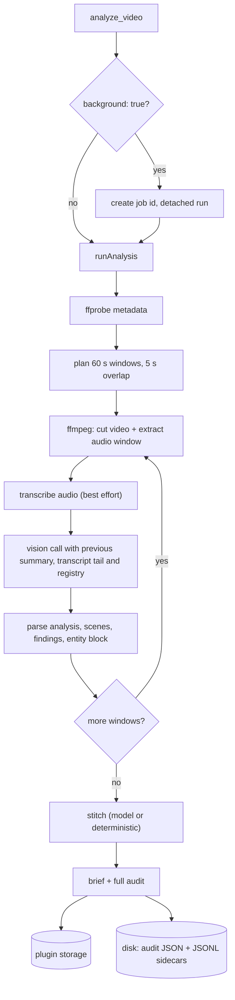

[Documentation index](README.md) · [Project home](../README.md)

# Architecture

This page describes the implementation that ships with plugin **2.7.0**. It
covers the modules, the analysis pipeline, the continuity and entity model, the
two output surfaces, and the background-job lifecycle.

## Modules

| Path | Responsibility |
| --- | --- |
| `index.ts` | Plugin entry point. Registers the four tools, resolves provider and transcriber configuration, probes video, plans chunks, calls the vision model, maintains the entity registry, stitches, writes the audit, and owns background jobs and resume. |
| `transcription.ts` | Audio extraction and speech-to-text. Resolves the STT configuration, sends audio windows to the chosen engine, discovers the accepted request shape, and converts words or segments into cues. |
| `audit-reader.ts` | Pure readers over a finished audit. Builds the index map, selects sections and refs, applies time windows, and enforces output caps. It has no storage or tool dependency. |
| `explorer/` | A static, single-file HTML viewer plus a synthetic schema-1.5 fixture. It is not a plugin tool and needs no build step. |
| `scripts/` | Development checks (`check-package.mjs`, `check-viewer.mjs`, `check-audit-reader.mjs`), the static `serve.mjs` with HTTP range support, and fixture generation. |

OpenCode loads the plugin at start and hot-reloads edits to `index.ts`. The
plugin has one runtime dependency, `@opencode/plugin`, and shells out to
`ffmpeg` and `ffprobe`; there are no native Node addons.

## Run Pipeline



### 1. Resolve configuration

`analyze_video` resolves the vision provider and the transcriber before any
media is read. The provider is selected from the tool argument, plugin options,
environment and built-in default, in that order for the model. The transcriber
uses `tool argument → plugin options → environment → engine default`. See
[Configuration](CONFIGURATION.md).

The optional `observation` is normalized into `{ observer, intent, focus,
assumptions, questions, source }`. When no observation is supplied, the
observer defaults to “a general video analyst”, the intent defaults to the
prompt, and `source` is `"default"`.

### 2. Fingerprint and resume lookup

For a local file the plugin records path, size and modification time. It hashes
those together with the fixed chunk settings, the vision model, the STT
engine/model and the prompt into a 16-character `config_sha`. A matching
unfinished job is the only thing that permits reuse of earlier chunks. See
[Resume](#resume).

### 3. Probe and plan

`ffprobe` supplies duration, width, height, frame rate and audio presence. The
probe is best-effort: a failed probe returns zeroed metadata rather than failing
the run, and the first `ffmpeg` cut produces the clearer error.

Windows are planned as follows:

- videos of 60 seconds or less are one window starting at 0
- longer videos step by `CHUNK_SEC - OVERLAP_SEC` (55 seconds)
- each window lasts 60 seconds or until the file ends
- `parsing.strategy` is `"single"` for one window, otherwise `"chunked"`

The per-chunk video filter is `scale='min(1280,iw)':-2,fps=2`, which caps width
at 1280 and reduces frame rate to 2 fps to keep each request within provider
payload limits. Audio is extracted as a mono 16 kHz 64 kbps MP3 window with the
same start and duration, so transcript timings line up with video timings.

### 4. Analyze each chunk

Windows are processed sequentially, never in parallel. For each window the
plugin:

1. cuts the video chunk with `ffmpeg`
2. extracts the matching audio window (when the source has audio)
3. transcribes it with the configured engine
4. builds a prompt containing the user request, the observation, the previous
   summary and transcript tail, and a compact entity registry
5. calls the vision provider with a retry budget of three attempts
6. parses the prose analysis, the `---ENTITIES---` machine block, scenes,
   highlights and any timestamps recovered by the heuristic
7. updates the registry, appends findings and scenes, and checkpoints

A failed chunk is recorded as a failed segment, not discarded from the report.
`parsing.failures[]` carries the error, attempt count, recoverability flag and a
suggestion; `parsing.coverage` lists covered and uncovered ranges.

### 5. Stitch

For a multi-chunk run the default `stitch: "model"` makes one additional model
call over the chunk analyses plus a bounded transcript digest. It produces the
overall analysis and the `### Perspective verdict` section. `stitch: "none"`
joins the chunk summaries deterministically, avoiding the extra call.

### 6. Publish

The run produces both output surfaces: the answer-shaped brief and the complete
audit. Both are written to plugin storage, and by default the audit is also
exported to disk with two append-only sidecars. See
[Audit System](AUDIT-SYSTEM.md).

### URL mode

An `https://` input does not enter the chunk pipeline. The URL is sent directly
to the vision provider as the video input in a single call. There is no
`ffprobe`, no chunking, no audio extraction and no transcription in this mode;
the audit records `parsing.strategy = "single"` and one remote chunk. Use a
local file when chunking or audio analysis is required.

## Continuity Between Chunks

A chunk is not analyzed in isolation. Each prompt receives:

- a compact n-1 summary list (one line per completed chunk, capped at 300
  characters per chunk)
- the previous chunk's transcript tail (up to 220 characters)
- the compact entity registry, capped at 18 entities in the prompt

This is what lets a recurring speaker or object stay connected across a cut.
On resume, the continuity inputs are rebuilt from the reused completed chunks so
a continued run sees the same context as an uninterrupted one.

## Entity Registry

The vision model returns prose plus a machine block:

```jsonc
---ENTITIES---
{"scenes":[{"start":"mm:ss","end":"mm:ss","setting":"…","activity":"…","on_screen_text":["…"]}],
 "observed":[{"descriptor":"woman, light-blue hijab, glasses","same_as":"p3","at":"01:58"}],
 "new":[{"id":null,"kind":"person|object|place|ui_element|logo|text|other","label":null,"descriptor":"…","at":"02:10"}],
 "registry_note":null}
---END---
```

The plugin, not the model, owns identity:

- it assigns stable ids (`p1`, `u2`, `g1`, …)
- it merges `same_as` references
- it appends cue-accurate appearances
- it injects the registry into the next chunk so the model reuses ids

Fuzzy matching is deliberately conservative: stopwords and colour words are
ignored for similarity, and descriptors naming different colours are never
merged. Registry status is one of `populated`,
`empty_no_recurring_subjects`, or `extraction_failed`. A failed entity block
does not invalidate the prose analysis or the scenes.

`entities[]` is typed, so characterless footage is supported: `ui_element` for
screen recordings, `object` or `logo` for product footage. Scenes are always
produced, independent of whether any entity recurs.

Entity labels come from the model and are not disambiguated. Treat a label as a
lead, not a verified fact.

## Findings

The plugin does not decide what counts as a defect. Each chunk asks the model
for `highlights[]` tied to the request:

```jsonc
"highlights":[{"at":"mm:ss","kind":"defect|beat|quote|claim|topic|timestamp|other","text":"…"}]
```

Every model finding carries `source: "model"`, `chunk_index` and `at_sec`. A
regex heuristic can also recover timestamps from prose and marks them
`source: "heuristic"`. It does not invent defects, label defects or suppress
model findings. Because genre is expressed through the prompt rather than a
code path, the same pipeline works for testimonials, cooking videos and screen
recordings.

## Background Jobs and Concurrency

`background: true` creates a job id (`va_…`), starts a detached run with its own
`AbortController`, and returns immediately. Jobs:

- are single-flight per resolved file path; a second request for the same path
  returns the running job with `deduplicated: true`
- checkpoint the partial audit after planning and after every chunk
- have a 45-minute hard cap
- are pruned from storage after 24 hours
- can be aborted with `video_analysis_cancel`, which aborts in-flight fetch and
  ffmpeg work

`video_analysis_job` reads the live record when present, otherwise the stored
record. While a job is running, its `audit` is `null`; after completion the full
contract is available with `include: "audit"`.

## Resume

Re-running the same file with the same prompt and pipeline settings after a
cancellation, crash or timeout continues from the last completed chunk. No
extra argument is required: the run selects the newest unfinished job whose
fingerprint matches.

- completed chunks are adopted, including analysis, findings, scenes, transcript
  and entity appearances
- interrupted chunk records are discarded, not replayed, so the counters match
  one record per chunk
- sidecars are rebuilt from reused chunks at startup and then appended per new
  chunk, preventing duplicates
- `audit.resume` records `from_job_id`, `chunks_reused`, `chunks_discarded` and
  `config_sha`

Changing the file (including its modification time), the prompt, the chunk
settings, the vision model, or the STT engine/model produces a new fingerprint
and a fresh run rather than mixing pipelines in one report.

## Storage and Output Boundaries

There are two distinct stores, and they serve different consumers:

- **Plugin storage** is what `video_analysis_audit` reads. It has keys such as
  `job/<id>`, `audit/last` and `audit/<file>-<hash8>`.
- **Disk export** is what the HTML explorer and external tools read. It defaults
  to `./audit-output`, resolved against the OpenCode server's working directory.

The tool always reports the real path in `audit.file` and
`detailed_audit.file`. See [Audit System](AUDIT-SYSTEM.md) for the complete
layout.

## Design Boundaries

- The vision call expects the OpenAI Responses shape. A Chat Completions
  endpoint is not translated.
- Transcription is best-effort. A failed STT request records an attempt trail
  and the chunk still runs video-only.
- Container support is whatever `ffmpeg` can demux; `.mkv` and `.avi` are
  transcoded per chunk, which costs time.
- The plugin does not adjudicate identity or truth. It attributes claims to a
  timecode and records the provenance.

## Related Documentation

- [Installation](INSTALLATION.md) · [Configuration](CONFIGURATION.md) ·
  [Usage](USAGE.md)
- [Available Tools](TOOLS.md) · [Transcription](TRANSCRIPTION.md) ·
  [Audit System](AUDIT-SYSTEM.md)

---

[Documentation index](README.md) · [Project home](../README.md)
